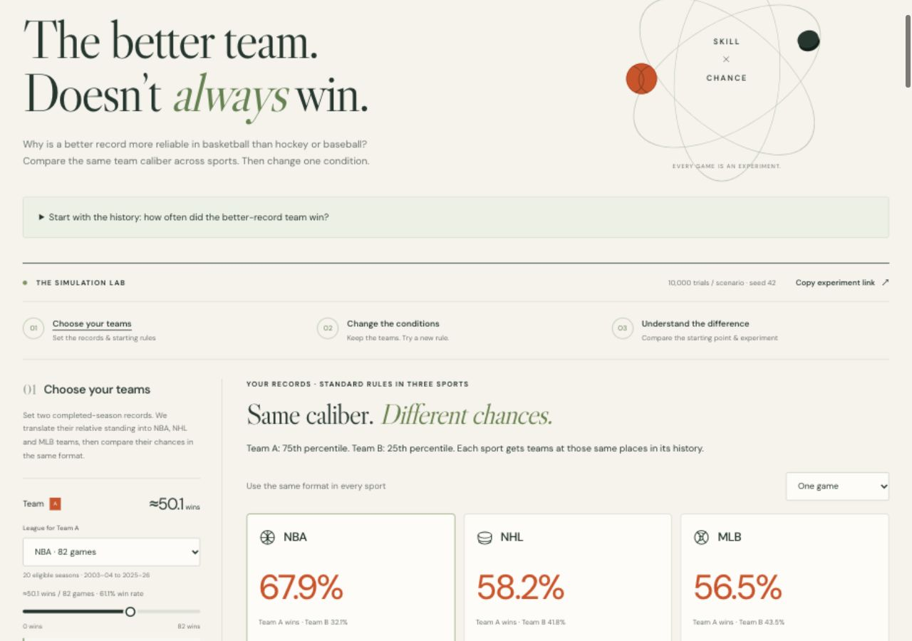
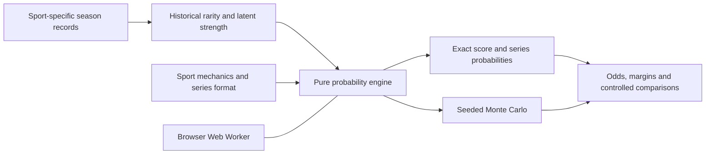

# LeagueLab

**The better team doesn't always win. Explore why.**

An interactive sports-variance simulator built by Teddy Hurley. Choose two teams by their season records, translate those records into a shared strength scale, then change the sport or format and see how the odds move.

Compare NBA, NHL, MLB, NFL and Premier League soccer. Explore questions such as **“What if hockey had more scoring?”** and **“What if the NBA were single elimination?”** through exact probabilities, seeded simulation and scoring-margin charts.



**Status:** working local prototype, prepared for GitHub. No public launch or completed independent usability study is claimed. Historical records ground all five input scales; all five sports have regular-season game fits and separate-season evaluations. All five models use season-end hindsight. MLB playoff transfer and some NBA/NHL/MLB/NFL subgroups still fail simple baselines. Cross-sport matchups and rule changes are explanatory experiments, not forecasts of real teams.

## Run locally

Requires **Node.js 22+**. No package installation, account, database or API key is needed.

```sh
npm run dev
```

Open **http://127.0.0.1:4173**. To use another port, run `PORT=8080 npm run dev`.

For a portable, single-file demo:

```sh
npm run standalone
```

Open the generated `LeagueLab.html` in your browser. It embeds the interface, probability engine and worker. Optional fonts fall back to system fonts offline. Shareable links require an HTTP/HTTPS-hosted copy. The generated HTML is ignored by Git; canonical source lives in `dist/`.

## Two-minute walkthrough

1. **Choose your teams.** Start with 75th- versus 25th-percentile NBA season caliber (about 50.1 vs 32.3 wins). Each record has its own league and scale. NHL and Premier League use points, matching how fans read standings.
2. **Compare the same caliber across NBA, NHL and MLB.** The opening cards use the same format, standard scoring and neutral venues. Change one game to best of seven for all three, then inspect a sport’s matchup. A and B odds describe the same contest; a single Premier League match also includes a draw probability. The possible outcomes sum to 100%. The starting scoring-margin chart sits beside that result.
3. **Change the conditions.** Keep those teams and build an experiment from the starting matchup. Try more hockey scoring or a shorter NBA series through **Try a guided experiment**.
4. **Understand the difference.** Compare the starting and experiment results, then inspect the ordered changes behind the modeled gap. Each result identifies its rules and format. Identical game conditions share a scoring chart; modified rules retain their own chart.
5. Optionally replay the same strengths under five standard sports, inspect **The model**, or export a completed run as JSON/CSV. A floating reminder flags edits that require a rerun.

The expandable historical check shows the observed better-record win rates (NBA 65.1%, NHL 58.6%, MLB 57.2%). Those are fixed sample summaries with unequal other-opponent records, not the selected matchup’s fitted odds. Standardized 75th-versus-25th-percentile one-game estimates are 67.9%, 58.2% and 56.5%. These comparisons do not identify the causal share due to scoring.

The displayed win odds and analytical charts come from exact calculations. Simulation separately shows repeated outcomes, convergence and sampling intervals. The 100 outcome squares are the first 100 actual sampled trials. More trials reduce simulation noise; they do not validate the assumptions.

## How it works



| Layer | Responsibility |
| --- | --- |
| `history.js`, `history-data.js` | Historical record distributions, rarity and translated record paces |
| `presets.js` | Versioned configuration, sport assumptions and input bounds |
| `engine.js` | Score distributions, exact series odds, seeded trials and controlled comparisons |
| `worker.js` | Background computation and progress reporting |
| `app.js`, `exports.js` | Interface state, charts, sharing and reproducible exports |
| `data/history/`, `scripts/history/build.py` | Source snapshots, provenance, fitting and temporal validation |

The engine has no DOM or network dependencies. Dynamic programming computes score distributions once; simulations sample their game probabilities. A worker keeps the interface responsive. Each run owns a validated configuration snapshot, and edited or canceled runs cannot silently overwrite a newer result. See [architecture decisions](docs/ARCHITECTURE.md).

## Evidence and boundaries

The record-rarity reference contains **2,849 team-seasons across the latest 20 eligible completed regular seasons per league**, as of October 7, 2026. Selected COVID seasons and shortened lockout seasons are excluded, with older seasons backfilled. **2021 MLB and NFL are included.** NBA uses ESPN standings; NHL/MLB use official APIs; NFL uses nflverse; Premier League uses OpenFootball. The separate outcome models fit **53,355 regular-season games** from 2015–16 through 2024–25, or 2015–2024 for MLB/NFL; those game samples include COVID years. [Historical evidence and provenance](docs/HISTORY.md) documents exact sources, exclusions and normalization.

- **Familiar inputs:** NBA 0–82 wins, NHL 0–168 points over the current 84-game schedule, MLB 0–162 wins, NFL 0–17 wins, Premier League 0–114 earned points. Premier League points exclude administrative deductions. Historical NHL records are normalized from 82-game seasons.
- **Disclosed translation:** historical rarity supplies a latent strength proxy. It is not true ability or a next-game probability. Records beyond the reference range are flagged and capped for modeling.
- **Five fitted baselines:** NBA/NHL/NFL use 11,979 / 12,200 / 2,614 regular-season games across all teams. Season-end records exclude every head-to-head meeting, but still use hindsight. Games involving non-playoff teams and playoff transfer are checked separately; no playoff adjustment is applied. MLB now uses 22,762 decisive completed-season observations with all head-to-head meetings removed, and checks playoff transfer separately. Premier League uses all 3,800 matches with season-end points excluding both head-to-head meetings, fitting win/draw/loss. All five leagues’ evaluation is retrospective, not forecasting accuracy. The five-rolling-season NBA bottom-quarter-pair check narrowly fails home-only. The NFL subset where both teams missed the playoffs still fails the home-only baseline, as do NFL/NHL/MLB games between two playoff teams. **MLB improves regular-season error but still fails playoff baselines.** [Evidence and validation report](docs/EVIDENCE.md).
- **Simplified competition:** single-game soccer keeps draws. Hypothetical soccer series and the other sports use fair deciders. Pitchers, rotations and lineups are not modeled.
- **Model uncertainty:** the ordered explanation depends on the order of changes. It is not a measured causal decomposition of real league differences. Sampling intervals cover Monte Carlo error only.

The in-app methodology explains the starting numbers. [MODEL.md](docs/MODEL.md) gives the equations, coefficients and limitations. Model v8.0.0 uses configuration schema v9. Older win-based NHL/Premier League links migrate to points by historical rarity with a visible notice; old NHL odds are not guaranteed to stay unchanged. Version 4/5 links preserve records/settings and show a notice about revised models. Version 6 links also disclose the expanded rarity reference. All older supported links disclose the completed-season MLB change and hindsight; records/settings are preserved, but prior odds can change.

Read the [release model review](docs/RELEASE-MODEL-REVIEW.md) for the NBA/NHL/MLB core comparison, five rolling-season evaluations, candidate tradeoffs and the completed-season MLB release decision. Version 8 implements the core NBA/NHL/MLB recommendation; the separate NFL challenger remains deferred.

## Verify and reproduce

```sh
npm test
npm run check
npm run check:history
python3 -m unittest discover -s tests -p 'test_*.py'
```

The historical check additionally requires **Python 3**. It rebuilds the five record distributions and all five game fits and feature audits and the MLB model comparison in a temporary directory, compares them with the shipped evidence, and leaves source files unchanged. No network is required.

To intentionally regenerate the evidence after reviewing source changes:

```sh
python3 scripts/history/build.py
```

GitHub Actions is configured to run tests, source checks and historical reproduction on pushes and pull requests. [Verification status](docs/VERIFICATION.md) separates completed checks from remaining browser and usability work.

## Hosting

`dist/` is ready for a static host; `npm run build` validates it without bundling. Serve this directory over HTTP/HTTPS rather than opening its `index.html` directly. Relative asset paths support repository subpaths.

A **manually triggered** GitHub Pages workflow is included. After adding the project to your chosen repository, select GitHub Actions as the Pages source and run **Deploy to GitHub Pages** when you want to publish. Pushing code alone does not trigger that deployment workflow. Hosting remains optional; the current demo stays local.

The app has no accounts or installed analytics and does not send simulation inputs to an API. Google Fonts is optional. Shared links contain the full experiment in the URL, which a hosting service can receive. Local hosting bindings, environment files and generated copies are excluded from Git.

## Product case study

Read [PRODUCT.md](docs/PRODUCT.md) for the original problem, scope decisions, feedback that shaped the interface, proposed pilot and launch plan. The main portfolio decisions are separating sport from format, grounding familiar records in historical rarity, communicating uncertainty, and keeping computation local without compromising reproducibility.

## License

Software: [MIT](LICENSE). Upstream historical data retain their own provenance and terms; the software license does not relicense those sources. Original sport illustrations use no league or team logos. League names are descriptive; LeagueLab is an independent project.
